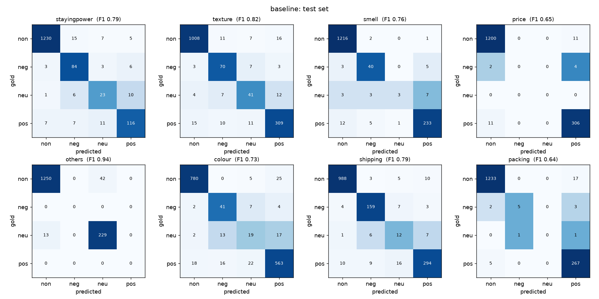
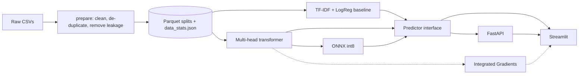

# ViABSA — Vietnamese Aspect-Based Sentiment Analysis

[](https://github.com/anhvinh205/based-sentiment-analysis/actions/workflows/ci.yml)


Given a Vietnamese cosmetics (lipstick) review, ViABSA predicts for **8 aspects** — staying power,
texture, smell, price, colour, shipping, packing, others — whether the aspect is *not mentioned*,
*negative*, *neutral* or *positive*, and can show **which words** drove each prediction.

> Review: *"Son lên màu chuẩn, mịn nhưng hơi khô môi, giá rẻ nên mình ok. Shop giao nhanh."*
> → colour: **positive** · texture: **negative** · price: **positive** · shipping: **positive**

**Live demo:** `TODO: add your Streamlit / Hugging Face Spaces link` ·
**Model:** `TODO: add your Hugging Face Hub link`



## What this project demonstrates

| Area | What is in the repo |
|---|---|
| **Data engineering** | CSV parsing that survives multi-line reviews, text normalisation (Unicode NFC, teencode, keyboard-mash removal), punctuation-insensitive de-duplication, conflicting-label detection, **train/val/test leakage removal**, data statistics report |
| **Modelling** | TF-IDF + logistic-regression baseline (per-aspect `C` tuned on validation) and a **multi-head transformer** (shared PhoBERT / XLM-R / ViSoBERT encoder, 8 heads × 4 classes) |
| **Imbalance** | Capped inverse-frequency class weights, optional focal loss, macro-F1 reporting with per-class support |
| **Training engineering** | Custom PyTorch loop: warm-up + linear decay, head learning-rate multiplier, no-decay groups, AMP, gradient clipping, early stopping, seeding, optional MLflow tracking |
| **Evaluation** | Per-aspect macro-F1, detection vs sentiment F1, calibration (ECE), slice analysis (template vs free-text reviews), confusion matrices, error-analysis export |
| **Explainability** | Integrated Gradients over input embeddings, merged back to words (PhoBERT BPE, SentencePiece, WordPiece); unit-tested with the completeness axiom |
| **Optimisation** | ONNX export + int8 dynamic quantisation with a parity check, latency/size benchmark script |
| **Serving** | FastAPI (pydantic schemas, validation, health/model-info, batch endpoint), Streamlit app with 4 tabs |
| **MLOps / quality** | Docker multi-stage build, docker-compose, GitHub Actions (ruff, mypy, pytest + coverage, torch/ONNX job, Docker build), pre-commit, Makefile, 40 tests |

## Results

Test set after cleaning: **1,534 reviews**. Metric: 4-class macro-F1 per aspect (over the classes that
occur in the gold labels), then averaged over aspects. Baseline numbers below were produced by
`make baseline` on a 1-vCPU machine; transformer rows are filled in by you after training.

| Model | Mean macro-F1 | Detection F1 | Sentiment F1 | ECE | Size | ms / review (batch 32, CPU) |
|---|---:|---:|---:|---:|---:|---:|
| TF-IDF + LogReg (baseline) | **0.765** | 0.949 | 0.709 | 0.043 | 11 MB | 0.4 |
| PhoBERT multi-head | TODO | TODO | TODO | TODO | TODO | TODO |
| XLM-R multi-head | TODO | TODO | TODO | TODO | TODO | TODO |
| ViSoBERT multi-head | TODO | TODO | TODO | TODO | TODO | TODO |
| Best model, ONNX int8 | TODO | TODO | TODO | TODO | TODO | TODO |

<details><summary>Baseline, per aspect</summary>

| Aspect | Macro-F1 | Detection F1 | Sentiment F1 | Accuracy |
|---|---:|---:|---:|---:|
| stayingpower | 0.794 | 0.933 | 0.773 | 0.947 |
| texture | 0.820 | 0.944 | 0.805 | 0.931 |
| smell | 0.761 | 0.966 | 0.691 | 0.973 |
| price | 0.650 | 0.963 | 0.488 | 0.982 |
| others | 0.936 | 0.893 | 0.972 | 0.964 |
| colour | 0.728 | 0.964 | 0.660 | 0.915 |
| shipping | 0.793 | 0.969 | 0.746 | 0.947 |
| packing | 0.642 | 0.958 | 0.536 | 0.981 |

</details>

**Reading the numbers honestly**

* Detecting *whether* an aspect is mentioned is easy (F1 ≈ 0.95); getting the *polarity* right is the hard part (0.71).
* `price` and `packing` have almost no negative/neutral examples: the test set has **6 negative and 0 neutral price reviews** and **10 negative and 2 neutral packing reviews**. Their F1 is dominated by a handful of examples and should not be over-interpreted.
* `others` only ever occurs as *neutral* in the data, so it behaves like a binary flag.
* Template reviews (marketplace auto-forms such as "Công dụng: … Kết cấu: …") are easier than free text: baseline macro-F1 0.845 (n=126) vs 0.759 (n=1,408).

## Quick start

### Windows (VS Code terminal / Command Prompt)

Requirements: Python 3.11+ and Git. The repository does **not** include the review dataset or trained
model weights. Get the dataset from a source whose terms allow your use, then place the three split
files in `data\raw\` as shown below. See [DATA_STATEMENT.md](DATA_STATEMENT.md) before sharing any
review data.

Run these commands from Command Prompt in the VS Code terminal:

```bash
git clone https://github.com/anhvinh205/based-sentiment-analysis.git
cd based-sentiment-analysis
py -3.11 -m venv .venv
.venv\Scripts\activate
python -m pip install --upgrade pip
python -m pip install -e ".[dev,serve,app,onnx]"
```

Copy `data_train.csv`, `data_val.csv`, and `data_test.csv` into `data\raw\`, then prepare the data
and train the CPU baseline:

```cmd
python -m viabsa.data.prepare --config configs/data.yaml
python -m viabsa.training.train_baseline --config configs/baseline.yaml
```

The trained model is written to `models\baseline`. Open two VS Code terminals (activate `.venv` in
each) to run the API and UI:

```cmd
set VIABSA_MODEL_PATH=models/baseline
uvicorn viabsa.serving.api:app --reload --port 8000
```

```cmd
set VIABSA_MODEL_PATH=models/baseline
streamlit run app/streamlit_app.py
```

Open the UI at `http://localhost:8501` and the API docs at `http://localhost:8000/docs`.

### Linux / macOS

```bash
git clone https://github.com/anhvinh205/based-sentiment-analysis.git
cd based-sentiment-analysis
python3 -m venv .venv
source .venv/bin/activate
python -m pip install --upgrade pip
python -m pip install -e ".[dev,serve,app,onnx]"
# Add the authorized data_train.csv, data_val.csv, data_test.csv to data/raw/
python -m viabsa.data.prepare --config configs/data.yaml
python -m viabsa.training.train_baseline --config configs/baseline.yaml
```

Then start the API and UI in separate terminals, setting
`VIABSA_MODEL_PATH=models/baseline` in each terminal before running the commands above.

### Train the transformers

```bash
python -m pip install -e ".[train]"
python -m viabsa.training.train_transformer --config configs/transformer_phobert.yaml
# Or use configs/transformer_xlmr.yaml or configs/transformer_visobert.yaml.
# A CUDA-compatible PyTorch installation and supported GPU are recommended.
python -m viabsa.export_onnx --model models/phobert --out models/phobert_onnx --quantize
python -m viabsa.benchmark --models models/baseline models/phobert models/phobert_onnx
mlflow ui                         # compare runs
```

Any hyper-parameter can be overridden, for example:
`python -m viabsa.training.train_transformer --config configs/transformer_phobert.yaml --set training.lr=3e-5 loss.focal_gamma=2`.

### Docker

First prepare the data and train the baseline as described above; Docker Compose mounts the local
`models/` folder and the trained model is not included in the image.

```bash
docker compose up --build
```

The API is available at `http://localhost:8000/docs` and Streamlit at `http://localhost:8501`.
To serve a different model directory, set `MODEL_DIR` to a folder under `models/` before starting
Compose (for example, in PowerShell: `$env:MODEL_DIR="phobert_onnx"; docker compose up --build`).

### API example

```bash
curl -X POST localhost:8000/predict -H 'content-type: application/json' \
     -d '{"texts": ["Son mịn, màu đẹp nhưng giao hàng hơi chậm"]}'
```

## Architecture



`Predictor` (`src/viabsa/inference.py`) hides whether the model is a scikit-learn pipeline, a PyTorch
checkpoint or an ONNX session, and reuses the **same preprocessing object** as training, so the
serving path cannot drift from the training path.

## Repository layout

```
src/viabsa/
├── data/          load, clean, prepare (dedupe + leakage), segment, dataset
├── models/        baseline.py, multihead.py
├── training/      train_baseline.py, train_transformer.py, class_weights.py
├── evaluation/    metrics.py (torch-free), report.py (plots, slices, error table)
├── explain.py     Integrated Gradients;  explain_utils.py  sub-word merging
├── export_onnx.py benchmark.py inference.py client.py tracking.py
└── serving/api.py
app/streamlit_app.py        configs/*.yaml        tests/        docker/        .github/workflows/ci.yml
```

## Design decisions worth discussing

* **Task formulation.** The labels are per *aspect category* (no word spans), so this is aspect-category sentiment, not the span-level ATE → ATSC pipeline of the AIO2025 tutorial that inspired the project. A single multi-task encoder is cheaper and lets aspects share representations.
* **Leakage control.** Duplicate and near-duplicate reviews are removed *across* splits (punctuation-insensitive key) so test scores are not inflated by memorised reviews; `data_stats.json` records how many rows were affected.
* **Metric choice.** Accuracy rewards the majority class (always answering "not mentioned" for `price` already scores 79%), so macro-F1 over present classes is the headline metric, with detection and sentiment F1 reported separately.
* **Rare classes.** Class weights use `(N / (K·n_c))^0.5` capped at 10, a compromise between ignoring and over-trusting the 15 negative price reviews in train.
* **PhoBERT input.** PhoBERT expects word-segmented text; the pipeline uses `pyvi` (VnCoreNLP would need Java).

## Limitations

* Single product category (lipstick), single marketplace style; no domain-shift evaluation.
* Rare classes are too small for reliable per-class estimates (see above); confidence intervals are not computed.
* Labels may contain annotation noise; 7 training texts appeared with conflicting labels and all their copies were dropped.
* Sarcasm, code-mixed and heavily abbreviated reviews remain error-prone. The teencode dictionary is intentionally tiny.

## Roadmap

- [ ] Bootstrap confidence intervals for every reported metric
- [ ] Continued masked-LM pre-training on additional Vietnamese e-commerce text
- [ ] Span-level aspect extraction (needs span annotations)
- [ ] Drift monitoring on live traffic

## Acknowledgements

Task framing inspired by the AIO2025 *Aspect-Based Sentiment Analysis* project brief. Dataset source and
licence: `TODO` (see `DATA_STATEMENT.md`). Backbones: PhoBERT (VinAI), XLM-RoBERTa (Meta AI), ViSoBERT (UIT NLP).

## License

MIT — see [LICENSE](LICENSE). Check the dataset's own licence before redistributing any data.
